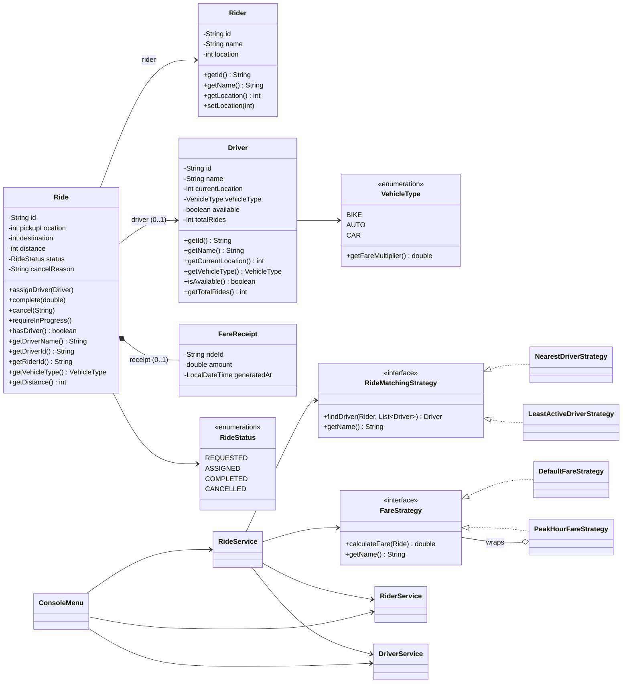

# RideWise: Class Model

## 1. Package Structure

```
src/com/airtribe/ridewise/
├── Main.java                         Composition root (wires everything)
├── console/
│   └── ConsoleMenu.java              UI and routing only
├── model/
│   ├── Rider.java
│   ├── Driver.java
│   ├── Ride.java                     Owns the ride state machine
│   ├── FareReceipt.java
│   ├── RideStatus.java               enum
│   └── VehicleType.java              enum (with fare multiplier)
├── strategy/
│   ├── RideMatchingStrategy.java     interface
│   ├── NearestDriverStrategy.java
│   ├── LeastActiveDriverStrategy.java
│   ├── FareStrategy.java             interface
│   ├── DefaultFareStrategy.java
│   └── PeakHourFareStrategy.java     decorator over another FareStrategy
├── service/
│   ├── RiderService.java
│   ├── DriverService.java
│   └── RideService.java
├── exception/
│   └── NoDriverAvailableException.java
└── util/
    ├── IdGenerator.java
    └── Validator.java
```

### Dependency direction

```
console ──► service ──► strategy ──► model ──► util
   │           │            │
   │           └──► model   └──► exception
   └──► model, strategy
Main ──► everything (composition root)
```

The `model` package depends only on `util`. It never imports `strategy`, `service` or `console`, so there are no circular dependencies.

## 2. Class Diagram



## 3. Model Layer

### Rider
| Member | Notes |
|--------|-------|
| `final String id` | Non-blank, validated in the constructor |
| `final String name` | Letters and spaces only (`Validator`) |
| `int location` | Non-negative; updated to the destination when a ride completes |

### Driver
| Member | Notes |
|--------|-------|
| `final String id`, `final String name` | Validated in the constructor |
| `int currentLocation` | Non-negative; moves to the destination when a ride completes |
| `final VehicleType vehicleType` | Required |
| `boolean available` | `true` on creation; set to `false` while assigned |
| `int totalRides` | Incremented only when a ride **completes**. Used by `LeastActiveDriverStrategy` |

### Ride
The central entity. It holds the rider, the optional driver, the locations, the status and the receipt, and it **owns all state transitions**.

| Member | Notes |
|--------|-------|
| `final String id`, `final Rider rider` | Set at construction |
| `Driver driver` | `null` until assigned |
| `final int pickupLocation`, `destination`, `distance` | Captured at construction; `distance = |destination - pickup|` |
| `RideStatus status` | Starts as `REQUESTED` |
| `FareReceipt receipt` | `null` until completed; created by the ride itself |
| `String cancelReason` | Set on cancel |

| Method | Behaviour |
|--------|-----------|
| `assignDriver(Driver)` | Only from `REQUESTED`; rejects `null`; moves to `ASSIGNED` |
| `complete(double amount)` | Only from `ASSIGNED`. Builds the receipt **first**, so a failure leaves state untouched. Then sets `COMPLETED`, moves rider and driver to the destination, increments the driver's ride count |
| `cancel(String reason)` | Rejected if already `COMPLETED` or `CANCELLED`; sets `CANCELLED` and stores the reason |
| `requireInProgress()` | Throws `IllegalStateException` unless `ASSIGNED` |
| `hasDriver()`, `getDriverId()`, `getDriverName()`, `getVehicleType()`, `getRiderId()` | Delegating getters (Law of Demeter) |

Constructor rules: non-blank ID, non-null rider, destination non-negative and different from the rider's location.

### FareReceipt
Immutable (all fields `final`): `rideId`, `amount`, `generatedAt` (set to `LocalDateTime.now()` at construction). Rejects a blank ride ID and a negative amount.

### Enums
| Enum | Values |
|------|--------|
| `RideStatus` | `REQUESTED`, `ASSIGNED`, `COMPLETED`, `CANCELLED` |
| `VehicleType` | `BIKE(0.5)`, `AUTO(0.8)`, `CAR(1.0)`, each with `getFareMultiplier()` |

## 4. Strategy Layer

### RideMatchingStrategy
```java
Driver findDriver(Rider rider, List<Driver> availableDrivers);
String getName();
```
**Contract:** returns an eligible driver (never `null`) or throws `NoDriverAvailableException`.

| Implementation | Rule | Constructor |
|----------------|------|-------------|
| `NearestDriverStrategy` | Smallest distance within the radius | `maxRadius > 0` |
| `LeastActiveDriverStrategy` | Fewest completed rides within the radius | `maxRadius > 0` |

### FareStrategy
```java
double calculateFare(Ride ride);
String getName();
```
**Contract:** returns a non-negative fare for a ride that has a driver.

| Implementation | Formula | Constructor |
|----------------|---------|-------------|
| `DefaultFareStrategy` | `(base + distance × perKm) × vehicleMultiplier` | `base >= 0`, `perKm >= 0` |
| `PeakHourFareStrategy` | `baseStrategy.calculateFare(ride) × surge` | non-null base, `surge > 0` |

## 5. Service Layer

| Service | Responsibilities | Collaborators |
|---------|------------------|---------------|
| `RiderService` | Register riders, look up a rider by ID (throws if not found) | `IdGenerator` |
| `DriverService` | Register drivers, list available drivers, update availability (throws if ID unknown) | `IdGenerator` |
| `RideService` | Request, complete and cancel rides; prevent double booking; delegate matching and pricing to strategies; allow runtime strategy swap | `RiderService`, `DriverService`, `RideMatchingStrategy`, `FareStrategy`, `IdGenerator` |

Internal state of `RideService`: a `LinkedHashMap<String, Ride>` (ordered, deterministic) and a `HashSet<String>` of rider IDs with an active ride.

## 6. Exception and Utility Classes

| Class | Purpose |
|-------|---------|
| `NoDriverAvailableException` (extends `RuntimeException`) | Thrown by matching strategies when no eligible driver exists |
| `IdGenerator` | Synchronized incrementing counter starting at 1 |
| `Validator` | Final utility class; `validateName(name, entityType)` |

## 7. Presentation and Composition

| Class | Role |
|-------|------|
| `ConsoleMenu` | Reads input, calls services, prints results, maps exceptions to messages. Contains no business rules |
| `Main` | Composition root. Builds services, builds the two strategy registries (`LinkedHashMap<String, …>`), injects defaults (option "1" of each) into `RideService`, and passes the registries to `ConsoleMenu` |