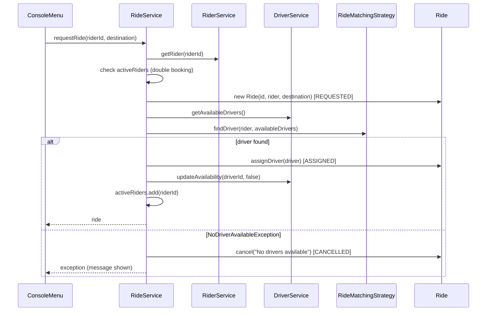
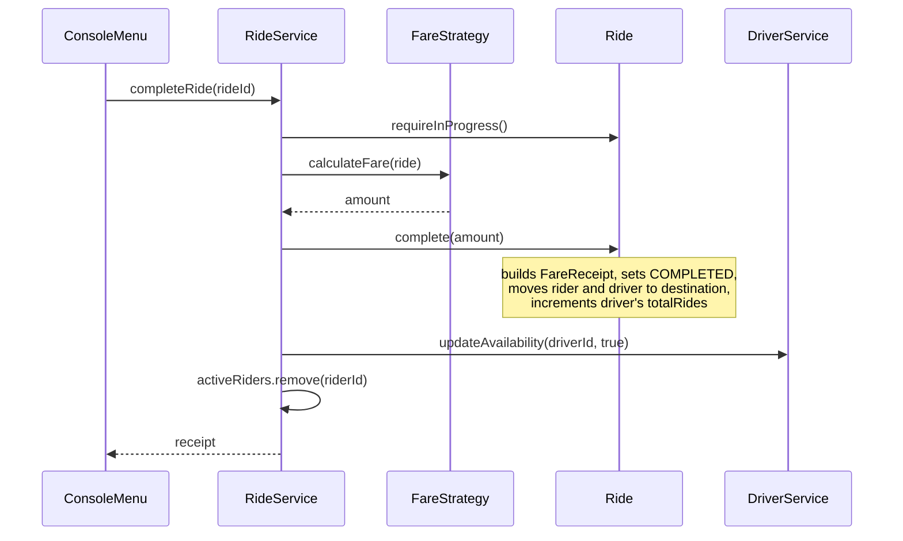

# RideWise: Object Relationships

This document classifies how the objects in RideWise relate to each other and explains why each relationship was chosen.

## 1. Relationship Summary

| From | To | Type | Multiplicity | Where in code |
|------|----|------|--------------|---------------|
| `Ride` | `Rider` | Association | many rides : 1 rider | `Ride.rider` |
| `Ride` | `Driver` | Association | many rides : 0..1 driver | `Ride.driver` |
| `Ride` | `FareReceipt` | **Composition** | 1 : 0..1 | `Ride.receipt`, created in `Ride.complete` |
| `Ride` | `RideStatus` | Association (enum value) | 1 : 1 | `Ride.status` |
| `Driver` | `VehicleType` | Association (enum value) | many : 1 | `Driver.vehicleType` |
| `RideService` | `RideMatchingStrategy` | **Composition / dependency injection** | 1 : 1 | constructor and `setMatchingStrategy` |
| `RideService` | `FareStrategy` | **Composition / dependency injection** | 1 : 1 | constructor and `setFareStrategy` |
| `RideService` | `RiderService`, `DriverService` | Association (collaboration) | 1 : 1 each | constructor |
| `PeakHourFareStrategy` | `FareStrategy` | Aggregation (Decorator) | 1 : 1 | constructor |
| `NearestDriverStrategy`, `LeastActiveDriverStrategy` | `RideMatchingStrategy` | Realization (implements) | n/a | `implements` |
| `DefaultFareStrategy`, `PeakHourFareStrategy` | `FareStrategy` | Realization (implements) | n/a | `implements` |
| `ConsoleMenu` | services and strategy registries | Association | 1 : 1 each | constructor |
| `Main` | all of the above | Creates and wires | n/a | `main()` |

## 2. Detailed Explanations

### 2.1 Rider → Ride and Driver → Ride: Association

A `Ride` holds references to a `Rider` and a `Driver`, but it neither creates nor destroys them. A rider exists before requesting a ride and continues to exist after it. A driver serves many rides over time. Their lifecycles are independent of any single ride, so this is a plain **association**, not aggregation or composition.

- The driver reference is **optional** (`0..1`). It is `null` while the ride is `REQUESTED` and for rides auto-cancelled because no driver was found.
- `hasDriver()` expresses this explicitly so callers never rely on a placeholder string.

### 2.2 Ride → FareReceipt: Composition

A `FareReceipt` has no meaning without its ride. `Ride.complete(double amount)` builds the receipt itself (`new FareReceipt(id, amount)`), and the receipt is stored only inside that ride. The receipt's lifecycle is bound to the ride's lifecycle: no ride, no receipt. The service never constructs receipts; it only asks the ride for the one it owns.

### 2.3 RideService → Strategies: Composition and dependency injection

`RideService` is *composed of* a matching strategy and a fare strategy, and **behaviour is delegated** to them instead of being inherited:

```java
Driver matched = matchingStrategy.findDriver(rider, availableDrivers);
double amount  = fareStrategy.calculateFare(ride);
```

The strategies are created outside the service (in `Main`) and injected through the constructor. The service holds only the interface types, so any implementation can be substituted, including at runtime through `setMatchingStrategy` and `setFareStrategy`. This is **composition over inheritance**: there is no `RideService` subclass per algorithm.

### 2.4 PeakHourFareStrategy → FareStrategy: Decorator

`PeakHourFareStrategy` both *implements* `FareStrategy` and *wraps* another `FareStrategy`:

```java
new PeakHourFareStrategy(new DefaultFareStrategy(50.0, 10.0), 1.5)
```

Its `calculateFare` calls the wrapped strategy and multiplies the result by the surge. Peak pricing therefore reuses the base formula (including the vehicle multiplier) instead of copying it, and any other `FareStrategy` could be wrapped the same way.

### 2.5 RideService → RiderService and DriverService: Collaboration

`RideService` uses the other two services to look up a rider, list available drivers and toggle driver availability. It depends on the concrete classes. This is a conscious YAGNI decision, documented in `SOLID_Reflection.md`.

## 3. Package Dependencies

```
console ──► service ──► strategy ──► model ──► util
              │             │
              └──► model    └──► exception
```

| Package | May depend on | Must not depend on |
|---------|---------------|--------------------|
| `model` | `util` | `strategy`, `service`, `console` |
| `strategy` | `model`, `exception` | `service`, `console` |
| `service` | `model`, `strategy`, `exception`, `util` | `console` |
| `console` | `service`, `model`, `strategy` | n/a |
| `Main` | all packages | n/a |

Dependencies point one way only, so there are no cycles. In particular, `Ride` does not know that strategies exist; the service computes the amount and hands it to `Ride.complete`.

## 4. Interaction Flows

### 4.1 Request a ride



### 4.2 Complete a ride



### 4.3 Cancel a ride

1. `RideService.cancelRide` loads the ride and calls `ride.cancel("User requested cancellation")`, which rejects completed or already-cancelled rides.
2. If `ride.hasDriver()`, the driver is made available again.
3. The rider is removed from `activeRiders`.

## 5. Object Lifecycles

| Object | Created by | Lives until |
|--------|-----------|-------------|
| `Rider` | `RiderService.registerRider` | Application exit |
| `Driver` | `DriverService.registerDriver` | Application exit |
| `Ride` | `RideService.requestRide` | Application exit (kept in history, including cancelled rides) |
| `FareReceipt` | `Ride.complete` | Same as its ride |
| Strategies | `Main` | Application exit; can be swapped at runtime |